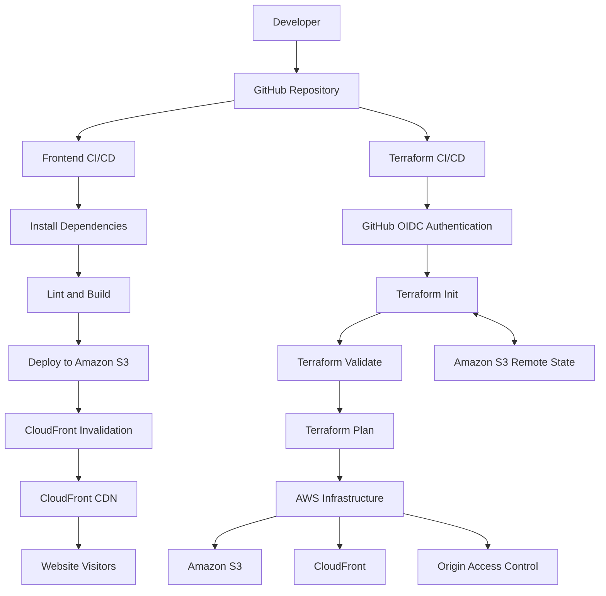

# FitZone — AWS Cloud Infrastructure & CI/CD Automation

A cloud-hosted fitness website deployed on AWS, with automated frontend delivery, Infrastructure as Code using Terraform, and independent GitHub Actions CI/CD pipelines.

**Live Website:** https://fitzone-demo.site  
**GitHub Repository:** https://github.com/suphinhazainarr/fitzone-cicd-deployment

---

## Project Overview

FitZone is a React-based gym website hosted on AWS. This project focuses on building and automating the cloud infrastructure and deployment process using AWS services, Terraform, and GitHub Actions.

The infrastructure is managed using Terraform, while the frontend application and infrastructure configuration have separate CI/CD pipelines.

The project demonstrates:

- Hosting a React application using Amazon S3 and CloudFront.
- Automating frontend deployment through GitHub Actions.
- Managing existing AWS infrastructure using Terraform.
- Storing Terraform state remotely in Amazon S3.
- Implementing native S3 state locking.
- Using GitHub Actions with AWS IAM OIDC authentication.
- Separating application deployment and infrastructure workflows.

## Architecture

### High-Level Architecture



## Technology Stack

| Category | Technologies |
|---|---|
| Frontend | React, TypeScript, Vite |
| Cloud Platform | AWS |
| Object Storage | Amazon S3 |
| CDN | Amazon CloudFront |
| Origin Security | CloudFront Origin Access Control (OAC) |
| Infrastructure as Code | Terraform |
| CI/CD | GitHub Actions |
| Authentication | AWS IAM, GitHub OIDC |
| State Management | Terraform S3 Backend |
| Version Control | Git, GitHub |

## AWS Infrastructure

The website is hosted using Amazon S3 and distributed through Amazon CloudFront.

### 1. Amazon S3

- Hosts the production React application build files.
- Uses S3 Block Public Access settings.
- Allows CloudFront to retrieve website objects through a bucket policy.
- Uses CloudFront as the public entry point for website delivery.

### 2. Amazon CloudFront

- Distributes website content through a CDN.
- Supports HTTPS using an ACM certificate.
- Uses a custom domain configuration.
- Redirects HTTP requests to HTTPS.
- Uses a default root object of `index.html`.
- Includes custom error responses for React single-page application routing.

### 3. CloudFront Origin Access Control

Configured CloudFront Origin Access Control (OAC) to allow CloudFront to access the private S3 origin using AWS Signature Version 4.

This avoids exposing the S3 bucket directly to public access.

## CI/CD Implementation

The repository contains two independent GitHub Actions workflows.

### 1. Frontend CI/CD Pipeline

**Workflow:** `.github/workflows/deploy.yml`

Triggered when changes are pushed to the `main` branch affecting the `frontend/` directory or the frontend deployment workflow.

Pipeline stages:

1. Checkout repository.
2. Install pnpm.
3. Install dependencies using the frozen lockfile.
4. Run Oxlint.
5. Build the React application.
6. Configure AWS credentials using GitHub OIDC.
7. Synchronize the production build with Amazon S3.
8. Create a CloudFront invalidation.

Deployment command:

```bash
aws s3 sync dist/ s3://YOUR_S3_BUCKET --delete
```

CloudFront invalidation:

```bash
aws cloudfront create-invalidation \
  --distribution-id YOUR_DISTRIBUTION_ID \
  --paths "/*"
```

### 2. Terraform CI/CD Pipeline

**Workflow:** `.github/workflows/terraform.yml`

Triggered when changes are pushed to the `main` branch affecting the `terraform/` directory or the Terraform workflow.

Pipeline stages:

1. Checkout repository.
2. Configure Terraform.
3. Authenticate with AWS using GitHub OIDC.
4. Check Terraform formatting.
5. Initialize Terraform.
6. Validate Terraform configuration.
7. Generate an execution plan.

Terraform commands:

```bash
terraform fmt -check -recursive

terraform init -input=false

terraform validate

terraform plan -input=false -no-color
```

The pipeline currently performs validation and planning only. It does not automatically apply infrastructure changes.

## Terraform Infrastructure Management

Terraform is used to manage the existing AWS infrastructure.

The following resources are currently managed:

| Resource | Terraform Resource |
|---|---|
| S3 Bucket | `aws_s3_bucket` |
| S3 Public Access Block | `aws_s3_bucket_public_access_block` |
| S3 Bucket Policy | `aws_s3_bucket_policy` |
| CloudFront OAC | `aws_cloudfront_origin_access_control` |
| CloudFront Distribution | `aws_cloudfront_distribution` |

Existing AWS resources were imported into Terraform state, and the configuration was aligned with the existing infrastructure.

## Remote State Management

Terraform state is stored remotely in Amazon S3 rather than relying exclusively on a local state file.

Configuration highlights:

- Dedicated S3 bucket for Terraform state.
- Remote state storage.
- Server-side encryption.
- S3 bucket versioning enabled.
- Native S3 state locking using `use_lockfile = true`.

Example backend configuration:

```hcl
terraform {
  backend "s3" {
    bucket       = "YOUR_TERRAFORM_STATE_BUCKET"
    key          = "fitzone/terraform.tfstate"
    region       = "us-west-2"
    encrypt      = true
    use_lockfile = true
  }
}
```

S3 state locking helps prevent concurrent Terraform operations from modifying the same state simultaneously.

## Security Implementation

Security considerations implemented in this project include:

- GitHub Actions authenticates with AWS using OpenID Connect (OIDC).
- No long-lived AWS access keys are stored in GitHub workflow files.
- Separate IAM roles are used for frontend deployment and Terraform CI/CD.
- The Terraform role uses a repository and branch-restricted trust policy.
- Terraform IAM permissions are scoped to the resources and operations required by the workflow.
- The website S3 bucket blocks public access.
- CloudFront accesses the S3 origin through OAC.

## Repository Structure

```text
FitZone/
│
├── .github/
│   └── workflows/
│       ├── deploy.yml
│       └── terraform.yml
│
├── frontend/
│   ├── public/
│   ├── src/
│   ├── aws/
│   ├── package.json
│   ├── pnpm-lock.yaml
│   └── vite.config.ts
│
└── terraform/
    ├── main.tf
    ├── .gitignore
    └── .terraform.lock.hcl
```

## Running the Frontend Locally

Prerequisites:

- Node.js
- pnpm

Clone the repository:

```bash
git clone https://github.com/suphinhazainarr/fitzone-cicd-deployment.git

cd fitzone-cicd-deployment/frontend
```

Install dependencies:

```bash
pnpm install
```

Start the development server:

```bash
pnpm dev
```

Run lint checks:

```bash
pnpm lint
```

Build for production:

```bash
pnpm build
```

## Running Terraform Locally

Prerequisites:

- Terraform CLI
- AWS CLI
- AWS credentials with appropriate permissions

Navigate to the Terraform directory:

```bash
cd terraform
```

Initialize Terraform:

```bash
terraform init
```

Validate the configuration:

```bash
terraform validate
```

Check formatting:

```bash
terraform fmt -check -recursive
```

Generate an execution plan:

```bash
terraform plan
```

**Note:** Terraform initialization uses the configured remote S3 backend. Appropriate AWS permissions and access to the existing state are required.

## Key Learning Outcomes

Through this project, I gained practical experience with:

- Deploying and hosting a frontend application on AWS.
- Configuring S3 and CloudFront for secure content delivery.
- Automating application deployment using GitHub Actions.
- Managing existing AWS infrastructure using Terraform.
- Configuring remote Terraform state and state locking.
- Implementing GitHub OIDC authentication with AWS IAM.
- Designing separate CI/CD workflows for application and infrastructure.
- Debugging IAM permission issues during Terraform execution.

## Future Improvements

- Introduce Terraform plan artifacts for pull request reviews.
- Implement approval-controlled infrastructure deployment.
- Add automated infrastructure drift detection.
- Improve infrastructure monitoring and alerting.
- Expand Terraform management to additional AWS resources.

---

## Author

**Suphin Hassainar**

Aspiring DevOps Engineer | AWS | Terraform | Kubernetes | CI/CD

GitHub: https://github.com/suphinhazainarr

